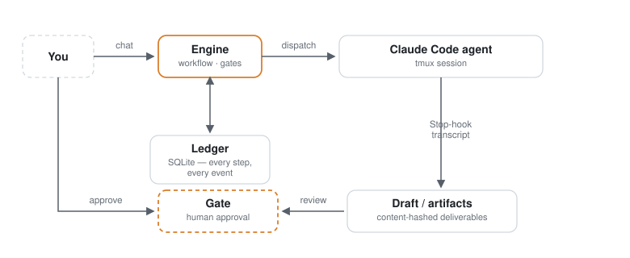

# juli

**Human-in-the-loop agent workflow engine.** Chat a task in — a Claude Code agent actually does the work inside tmux — you approve the result at the gate.



juli is not a chat wrapper. It is a small production engine around autonomous
agents:

- **Real execution.** Agents run as Claude Code REPLs in tmux sessions. The
  engine dispatches prompts with submit-confirmation, watches liveness,
  heals zombie sessions, and captures output through a Stop-hook channel —
  never by scraping the terminal.
- **A ledger, not vibes.** Every workflow, step, gate decision, and token
  spend lands in an event ledger (`node:sqlite`, zero external DB). Runs are
  auditable after the fact; costs are metered per run.
- **Humans at the gates.** Drafts and outgoing email stop at approval gates.
  Nothing leaves without an explicit human (or explicitly configured rule)
  approving it. Gates carry the rendered artifact inline — the review surface
  *is* the gate card.
- **One AI config, two consumers.** A single `ai` section drives both the
  engine's own LLM calls and the `ANTHROPIC_API_KEY` / `ANTHROPIC_BASE_URL`
  environment injected into every agent session — point `base_url` at any
  Anthropic-compatible endpoint (e.g. GLM) and you are off Anthropic billing.

## The 30-minute tour

### 1. Start it (Docker, ~10 minutes)

```bash
git clone https://github.com/juli-os/juli && cd juli
echo JULI_PASSWORD=pick-a-password > .env
docker compose up -d --build
open http://localhost:7170
```

The image carries everything: engine + web cockpit + tmux + Claude Code.
State (SQLite ledger, config, pipelines) lives in `./data`.

Bare metal works too (Node ≥ 22.13, tmux):

```bash
npm install
npm run setup        # interactive: checks/installs tmux + Claude Code,
                     # writes the ai section, runs an end-to-end self-check
npm run build && npm run web
JULI_PASSWORD=pick-a-password npm start
```

### 2. Configure AI (the only required step)

The cockpit shows a prominent banner until AI is configured — no silent
degradation. Either:

- **Web:** log in with your password → **Settings → AI** → paste an API key →
  *Test connectivity* → *Save*, or
- **CLI:** `npm run setup -- --api-key sk-… [--base-url https://…] [--model …]`
  (inside Docker: `docker compose exec juli npx tsx cli/juli.ts setup`), or
- **Env:** `JULI_AI_API_KEY` (+ optional `JULI_AI_BASE_URL`, `JULI_AI_MODEL`).

`base_url` empty = official Anthropic API. `base_url` set = any
Anthropic-compatible endpoint (GLM, proxies, gateways). The same key powers
engine-side LLM calls (chat intake, drafting) and agent sessions.

### 3. Hand it a task (web chat)

Go to **Chat** (发单). Describe what you want. juli runs a short clarify loop,
proposes the task card (title + brief + landing session), and shows a route
plan. Press **开单** (create) — that button is the only way a task is born.

### 4. Watch the agent work

- **Runs** (流水): the run timeline — every step, event, and artifact.
- **Sessions** (会话): live terminal into the agent's tmux session. This is
  the *actual* REPL, not a mock — type `/clear` if you like.

### 5. Approve at the gate

When a step needs you (draft review, send approval), a gate card appears on
the run with the rendered artifact inline. **Approve**, **Rework** with
feedback, or **Align** to hand down a human-amended version. Approved sends
go out via SMTP (if configured).

That's the MVP loop. Optional next step: wire [email intake](#email-intake-optional)
so customers can start runs by sending mail.

## Configuration

`config.json` lives in the data dir (`~/.juli-service/` locally, `/data/`
in Docker — the engine follows `JULI_DATA_DIR`). See
[`config.example.json`](config.example.json) for the common fields.

The effective AI resolution order is `JULI_AI_*` env > `ai` section >
legacy `llm_*` / `secrets.llm_api_key` fields.

Key env vars: `JULI_DATA_DIR`, `JULI_LISTEN_HOST`, `JULI_LISTEN_PORT`,
`JULI_PASSWORD` (required when listening off-loopback), `JULI_AI_API_KEY`,
`JULI_AI_BASE_URL`, `JULI_AI_MODEL`.

### Email intake (optional)

Chat is the zero-config intake. Email intake is a configuration chapter, not
a prerequisite: point `email.*` (IMAP) + `smtp.*` at a mailbox, allowlist
senders (`email_authz_allow`, fail-closed by default), and inbound mail
starts runs through the same engine — replies wait at a send gate. See
`config.example.json` and Settings.

## Deployment

Prebuilt images: `ghcr.io/juli-os/juli` (multi-arch, tagged releases).

One-command cloud deployments (Terraform / Cloud Run / Aliyun SAE) live in
[`deploy/`](deploy/) — each with a README covering the minimal monthly setup.
Single instance only: the ledger is SQLite, so scale-out is intentionally out
of scope for the MVP.

### Building the image behind an intercepting proxy

The apt step uses plain-HTTP Debian mirrors (GPG-signed; slim has no CA store,
so HTTPS apt fails on a stock image). Behind a fake-IP/TUN proxy, pass the
proxy explicitly so apt and npm go through a real CONNECT tunnel:

```bash
make docker-build DOCKER_BUILD_ARGS="--build-arg http_proxy=http://host.docker.internal:7897 --build-arg https_proxy=http://host.docker.internal:7897"
```

## Security notes

- All `/api/*` routes require the Bearer password (constant-time compare)
  when one is set; the engine refuses to bind non-loopback without one.
- The web terminal (`/ws/xterm/{session}`) is authenticated with the same
  password and mediates tmux sessions the engine owns.
- Secrets are masked on every `GET /api/settings`; masked values sent back
  are stripped, never written.
- The AI key reaches agent sessions through the tmux server's in-memory
  environment — it is never written to disk and never appears in process
  command lines.
- `config.example.json` contains no real endpoints or keys.

## Architecture, briefly

| Layer | What it is | Where |
|---|---|---|
| Engine core | workflow lifecycle, gates, intake, send | `src/business/workflow` |
| Routing | deterministic session routing (+ optional Jev judgment, default off) | `@juli-os/routing` |
| Agent runtime | tmux-first dispatch, submit confirmation, provisioning | `@juli-os/agents` |
| Ledger | SQLite event store, usage/cost metering | `@juli-os/ledger` |
| Artifacts | content-addressed deliverables (md/html trio) | `@juli-os/artifacts` |
| HTTP + web | hono API + cockpit SPA | `src/http`, `web/` |

This repository is published from the main development tree via an export
projection (allowlist → surgical trims → red-list scan → gate). Issues and
discussions are welcome here.

## License

Apache-2.0 — see [LICENSE](LICENSE).
